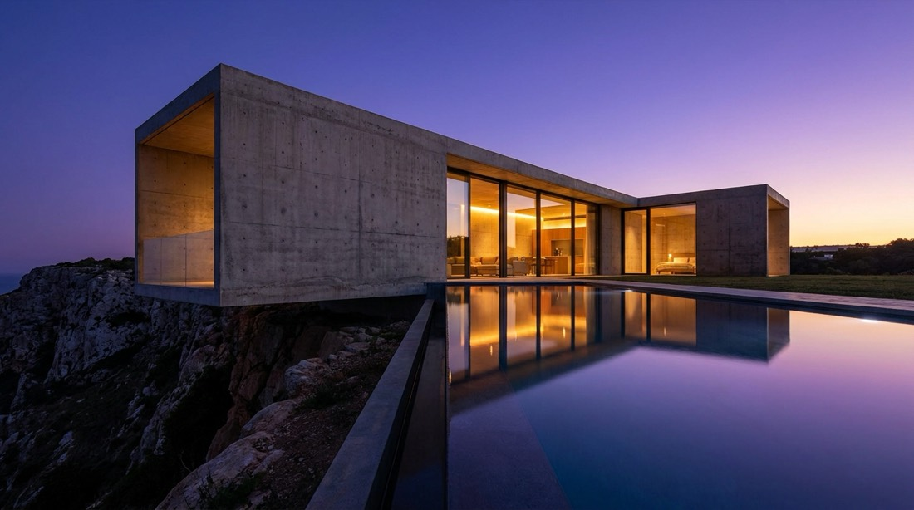

# FLUX 3 Image Prompts — 8 Tested Recipes With Outputs — passerelle API (Français)

<!-- conv-kit:v1 -->

<p align="center">
    
</p>

<p align="center">
  
</p>

> **$0.0384 per image** at 1k (768sq $0.0328 · 1.5k $0.056 · 2k $0.08 · 4k $0.4856) — one OpenAI-compatible endpoint at `https://api.apimart.ai/v1`, no monthly plan required. *(observed 2026-10-12)*

**[Obtenir une clé API](https://go.apimart.ai/k-9b11b4)** · **[Tarifs à jour](https://go.apimart.ai/k-3b53c6)** · **[Page du modèle](https://go.apimart.ai/k-431d51)** · [⚡ 60-second quickstart](#run-a-recipe-yourself)

**Why teams call FLUX 3 Image (`flux-3-image`) through APIMart**

- **One key, entire catalog.** The same `https://api.apimart.ai/v1` base URL and `Authorization` header reach FLUX 3 Image and 300+ other image, video and language models — switch the `model` field, not your client.
- **$1 minimum, pay as you go.** No subscription and no prepaid plan to size up front: top up from $1 and spend it on calls. There is no free quota to burn through first, so the price in this table is the price you pay.
- **The charge comes back in the response.** Every call reports the amount billed (`cost` / `credits_cost`), so a spend number is read per call instead of guessed at month end.
- **Async by design.** Submit, take the `task_id`, poll `GET /v1/tasks/{id}` — batching and retries are ordinary queue work, not a bespoke integration.

<!-- /conv-kit:v1 -->

FLUX 3 Image : une seule `base_url` compatible OpenAI et une seule clé donnent accès à FLUX 3 Image (`flux-3-image`) et à plus de 300 modèles image, vidéo et langage — facturation en USD, à l'usage, à partir de 1 $.

Eight **FLUX 3 Image prompts** listed with an example render, the aspect ratio, and what the call costs on this route. Copy a recipe, keep the structure, swap the subject.

- Model: `flux-3-image`
- Recipes: **8** (machine-readable in [`data/prompts.json`](data/prompts.json), table in [`PROMPTS.md`](PROMPTS.md))
- Estimated cost of the whole set: **$0.3072**

## What separates a usable recipe from a wasted call

Three rules held up across every render in this set:

1. **Name the material, not the adjective.** "Frosted glass", "matte ceramic", "layered paper" steer rendering far more
   than "beautiful" or "high quality".
2. **Set the light explicitly.** "Single softbox from the left", "golden hour backlight", "focus-stacked studio light"
   remove the guesswork the model would otherwise do for you.
3. **Pin the framing.** Ratio plus lens language (`85mm`, `24mm`, `macro`, overhead flat lay) decides whether the output
   drops into a layout unchanged.

## Prompt structure cheat-sheet

| Slot | What to write | Example |
| --- | --- | --- |
| Subject | one concrete object or person, with material | *frosted glass perfume bottle* |
| Light | direction + quality | *single softbox from the left* |
| Framing | ratio + lens or distance | *3:4, medium format look* |
| Setting | surface, backdrop, environment | *wet black stone slab* |
| Finish | render or film character | *commercial product photography* |

## The gallery

Each row is one recipe: example render, category, ratio, cost on this route and the exact prompt.

| Output | Recipe | Ratio | Cost | Prompt |
| --- | --- | --- | --- | --- |
|  | Product / e-commerce | 1:1 | $0.0384 | `Studio hero shot of a frosted glass perfume bottle on a wet black stone slab, single softbox from the left, faint mist, deep charcoal background, crisp label text, commercial product photography` |
|  | Food photography | 4:3 | $0.0384 | `Overhead flat lay of a spicy miso ramen bowl with soft boiled egg, nori and scallions, dark ceramic table, chopsticks resting on the rim, natural window light, editorial food photography` |
|  | Cinematic still | 16:9 | $0.0384 | `Rain soaked Kyoto alley at night, paper lantern reflections on wet stone, a lone figure with a transparent umbrella walking away, cinematic 35mm still, shallow depth of field, film grain` |
|  | Architecture | 16:9 | $0.0384 | `Minimalist concrete villa on a cliff at dusk, warm interior light, infinity pool reflecting a violet sky, architectural photography, 24mm perspective, ultra sharp` |
|  | Fashion portrait | 3:4 | $0.0384 | `Editorial fashion portrait of a model in an oversized ivory wool coat, seamless light grey studio backdrop, crisp high key lighting, medium format detail, calm expression` |
|  | Illustration | 1:1 | $0.0384 | `Layered paper cut illustration of a mountain lake at sunrise, five depth layers, soft pastel palette, subtle drop shadows, art print composition, clean vector edges` |
|  | Design / UI | 16:9 | $0.0384 | `Flat vector dashboard panel showing three gauge dials and abstract latency curves, muted blue and sand palette, generous white space, crisp geometric cards, no placeholder text` |
|  | Macro nature | 3:2 | $0.0384 | `Macro photograph of a dew covered dandelion seed head against deep black background, focus stacked detail, iridescent droplets, studio lighting` |

## Run a recipe yourself

```bash
export APIMART_API_KEY=...
python examples/run_recipes.py --dry-run                 # list the recipes, no network
python examples/run_recipes.py --limit 2                 # generate two of them
```

```bash
curl --request POST --url https://api.apimart.ai/v1/images/generations \
  --header "Authorization: Bearer $APIMART_API_KEY" --header 'Content-Type: application/json' \
  -d '{"model":"flux-3-image","prompt":"<paste a prompt>","size":"1:1","resolution":"1K"}'
```

Result links expire 72 hours after completion, so store the outputs; the completed task carries `cost` for reconciliation.

## FAQ

**Are these prompts free to reuse?**

Yes — the prompt text in this repository is MIT licensed. The generated images and any third-party marks they contain remain your responsibility, and you should check the model vendor's terms before publishing commercial work.

**Why do the recipes use different aspect ratios?**

Because ratio is a layout decision, not a style one: 1:1 for catalogue and icons, 16:9 for hero and video thumbnails, 3:4 or 2:3 for portraits and print. Pinning it up front avoids cropping later.

**How much does one recipe cost to run?**

Price depends on resolution, not on aspect ratio or the number of references.

**Can I use a recipe as a template for another subject?**

That is the point. Keep the structure (subject + light + framing + setting + finish) and replace the subject; changing everything at once makes it impossible to tell which phrase moved the output.

## Attributed links (how this repository is measured)

| Purpose | Attributed link | Target |
| --- | --- | --- |
| Page du modèle | <https://go.apimart.ai/k-431d51> | `apimart.ai/fr/model/flux-3-image` |
| Tarifs à jour | <https://go.apimart.ai/k-3b53c6> | `apimart.ai/fr/pricing` |
| Obtenir une clé API | <https://go.apimart.ai/k-9b11b4> | `apimart.ai/fr/keys` |

Outbound APIMart links are minted through the promo link API; hand-made tracking parameters are rejected by
`tools/check_links.py` in CI.

## Disclosure

FLUX 3 Image is a third-party model served through APIMart. This repository publishes prompts, example renders and
cost logic; it does not claim official status for any vendor, and model names and documentation belong to their owners.

## Repository map

```text
README.md              gallery, prompt structure and FAQ
PROMPTS.md             every recipe in one table
data/prompts.json      machine-readable recipes with per-image cost
examples/run_recipes.py  batch runner (dry-run safe for CI)
tools/check_links.py   attribution guard
assets/                example renders via the APIMart image API (JPEG)
```

## License

MIT — see [LICENSE](LICENSE).
